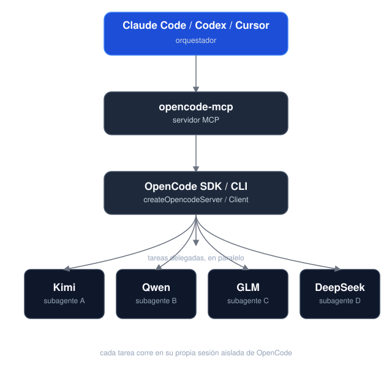

# opencode-mcp

[](https://github.com/alejandro-technology/opencode-mcp/actions/workflows/ci.yml)
[](https://github.com/alejandro-technology/opencode-mcp/blob/main/vitest.config.ts)
[](https://www.npmjs.com/package/mcp-server-opencode)

**Keep your lead agent lean and save tokens by delegating heavy tasks to background subagents.**

`opencode-mcp` is a Model Context Protocol (MCP) server that connects orchestrator hosts (Claude Code, Codex, Cursor, Antigravity, Pi) with [OpenCode](https://opencode.ai) subagents. Instead of polluting your orchestrator's context window with large file reads, extensive search outputs, and repetitive test runs, you delegate those tasks to isolated subagents and receive only concise, structured results.

### Why this matters (Context Window Economics)

- 🧠 **Prevent Context Rot & Bloat**: Monolithic agents suffer reasoning degradation as the context fills up. Keeping your lead agent as an orchestrator preserves high reasoning quality.
- 💰 **Slash Token Costs**: Running large exploratory reads or test-fix loops directly inside your primary (Fable/Opus, Astra/Sol) session repeatedly bills for thousands of cached tokens on every follow-up turn. Subagents run in isolated sessions using optimal models.
- ⚡ **Asynchronous Parallel Execution**: Dispatch multiple investigation or implementation tasks in parallel without blocking the orchestrator.

## Quick install

Requires **Node.js 18+** and **[OpenCode 1.x](https://opencode.ai)** installed and configured (`opencode` must be on your `PATH`, with at least one provider/model set up) — this server spawns and drives OpenCode instances.

For **Claude Code**:

```bash
claude mcp add opencode -- npx -y mcp-server-opencode
```

For **Codex**:
```bash
codex mcp add opencode -- npx -y mcp-server-opencode
```

See [Installation](#installation) for manual config, and from-source options.

## Tools

| Tool                       | Description                                                                                               |
| --------------------------- | -------------------------------------------------------------------------------------------------------- |
| `opencode_start_server`    | Start a new OpenCode server instance in the MCP process working directory                                 |
| `opencode_stop_server`     | Stop a running OpenCode server instance                                                                   |
| `opencode_list_agents`     | List agents/models available on a server instance (optional `directory` selects a project)                 |
| `opencode_start_task`      | Delegate a task to an agent by starting a new session and prompt (optional `agent` / `model` override)    |
| `opencode_continue_task`   | Send a follow-up prompt to an existing task's session for iterative back-and-forth with the subagent      |
| `opencode_cancel_task`     | Abort a running delegated task by cancelling its session                                                  |
| `opencode_cleanup_workspace` | Explicitly remove an owned Git worktree after task reports finalize; dirty worktrees require opt-in discard |
| `opencode_get_task_status` | Poll the status of a delegated task (`pending` / `running` / `completed` / `failed` / `empty` / `cancelled`); optional `include_progress` adds a partial output snippet and the currently running tool while it's still running |
| `opencode_get_task_result` | Fetch the final result of a completed task                                                                |
| `opencode_wait_for_task`   | Long-poll one or more delegated tasks until they finish (`mode: "all"` or `"any"`) or the timeout elapses; optional `include_progress` best-effort enriches unfinished tasks within the same deadline, falling back to the last observed status/progress when time runs out |

Delegation workflow and model-selection guidance are provided through the MCP server instructions.

## How it works


Task delegation is asynchronous: `opencode_start_task` returns a `task_id` and `run_id` without waiting, so hosts can start tasks in parallel. Tasks use the selected directory by default; managed Git worktrees are optional. Poll for status and retrieve results separately. If dispatch is uncertain, use the returned IDs to check or cancel the task instead of retrying it.

### Execution reports and caller checks

Start and continuation calls can include `expected_changes` and `checks`. Status and result responses report workspace changes, verification, diagnostics, and evidence; pass a `run_id` to retrieve a historical run. Workspace changes are best-effort evidence, since concurrent writers can make attribution uncertain.

### Shared directories and managed worktrees

Tasks run in the selected existing directory (`shared`, the default), or in an isolated managed Git worktree based on a commit. Worktrees are kept after execution; use `opencode_cleanup_workspace` with its `workspace_id` after reports are finalized. Cleanup only removes worktrees managed by this server, and dirty worktrees require explicit discard.

### Usage reporting

Status, wait, and result responses include run and session usage snapshots, with metrics broken down by provider and model. Missing metrics remain unknown rather than zero, and cost is OpenCode-reported—not an invoice total. Finalized runs retain their snapshots for historical retrieval.

Task, run, server, workspace, and usage records live in a SQLite database shared by every MCP process on the host (`OPENCODE_MCP_HISTORY_DB` overrides the location). Records survive restarts: retained worktrees are rediscovered for cleanup, and finalized runs remain retrievable by `run_id`.

## Installation

### Prerequisites

- **Node.js 18+**
- **[OpenCode 1.x](https://opencode.ai)** installed and configured (`opencode` must be on your `PATH`, with at least one provider/model set up) — this server spawns and drives OpenCode instances.

The current adapter uses the OpenCode v1 SDK/API and was validated against OpenCode `1.18.34` , `1.19.5`. OpenCode 2.x is not yet supported.

### Option 1 — npm (recommended)

The package is published as [`mcp-server-opencode`](https://www.npmjs.com/package/mcp-server-opencode). No cloning or building needed — point your MCP host at `npx`:

For **Claude Code**, one command does it:

```bash
claude mcp add opencode -- npx -y mcp-server-opencode
```

Or manually

```json
{
  "mcpServers": {
    "opencode": {
      "command": "npx",
      "args": ["-y", "mcp-server-opencode"]
    }
  }
}
```

For **Codex**, add the server to `~/.codex/config.toml`:

```toml
[mcp_servers.opencode]
command = "npx"
args = ["-y", "mcp-server-opencode"]
```

Or install it globally and use the binary directly:

```bash
npm install -g mcp-server-opencode
```

```json
{
  "mcpServers": {
    "opencode": {
      "command": "opencode-mcp"
    }
  }
}
```

### Option 2 — from source

```bash
git clone https://github.com/alejandro-technology/opencode-mcp.git
cd opencode-mcp
pnpm install
pnpm build
```

Then point your MCP host at the built entrypoint:

```json
{
  "mcpServers": {
    "opencode": {
      "command": "node",
      "args": ["/path/to/opencode-mcp/build/src/index.js"]
    }
  }
}
```

Restart your MCP host after editing the config; the `opencode_*` tools should appear in its tool list.

## Configuration

### `MCP_TOOL_TIMEOUT`

`opencode_wait_for_task` accepts a `timeout_ms` input, but it's clamped to a server-side maximum so a single call stays inside the calling host's own MCP request timeout. That maximum defaults to **55000 ms** and is configurable via `MCP_TOOL_TIMEOUT`.

The default is deliberately low: MCP hosts abort long tool requests with `MCP error -32001: Request timed out` before the tool can answer (observed on OpenCode hosts and the MCP Inspector at 100s+), so a graceful `timed_out: true` payload at 55s always beats a dead transport. Loop the wait — call `opencode_wait_for_task` again while `timed_out` is `true` — instead of raising `timeout_ms`. Raise this only when your host demonstrably tolerates longer tool requests.

`MCP_TOOL_TIMEOUT` can be set two ways:

- **Environment variable** — set it in the MCP server config:

  ```json
  {
    "mcpServers": {
      "opencode": {
        "command": "node",
        "args": ["/path/to/opencode-mcp/build/src/index.js"],
        "env": { "MCP_TOOL_TIMEOUT": "1200000" }
      }
    }
  }
  ```

- **CLI argument** — pass `MCP_TOOL_TIMEOUT=<ms>` as an extra arg to the server process:

  ```json
  {
    "mcpServers": {
      "opencode": {
        "command": "node",
        "args": [
          "/path/to/opencode-mcp/build/src/index.js",
          "MCP_TOOL_TIMEOUT=1200000"
        ]
      }
    }
  }
  ```

If both are present, the **environment variable takes precedence** over the CLI argument. Invalid or non-numeric values fall back to the 55000 ms default.

### Permissions and trust

Headless tasks automatically answer permission prompts. Set `OPENCODE_MCP_EXTERNAL_DIR` to `read-only` (default), `allow`, or `deny` to control external-directory requests. An environment variable takes precedence over an `OPENCODE_MCP_EXTERNAL_DIR=<policy>` CLI argument; explicit OpenCode deny rules remain in effect.

Use this server only with trusted hosts and repositories. Git worktrees isolate source changes, **not OS permissions**: agents and caller-provided checks run as your local user, not in a security sandbox.

## Development

### Project structure

```
src/
├── index.ts                   # MCP server entrypoint (stdio transport, shutdown handlers)
└── modules/
    ├── tools/                 # One file per MCP tool, registered in index.ts
    └── shared/                # Cross-tool infrastructure (selected modules below)
        ├── server-registry.ts   # Tracks running OpenCode servers
        ├── task-registry.ts     # Task/session identity and per-run history
        ├── opencode-client.ts   # SDK clients, status derivation, and progress
        ├── run-observer.ts      # Background run finalization and result caching
        ├── execution-report.ts  # Workspace evidence and executable checks
        ├── execution-usage.ts   # Run/session usage aggregation
        ├── workspace-manager.ts # Managed Git worktree lifecycle
        ├── permissions.ts       # Headless permission decisions and responses
        ├── instructions.ts      # Delegation workflow and model-selection guidance
        ├── config.ts            # MCP_TOOL_TIMEOUT resolution
        └── mcp-result.ts        # JSON tool result helpers
```

Each module ships with a `*.test.ts` Vitest suite under the parallel `tests/` tree mirroring `src/`.

### Getting started

Use **Node.js 22.18+** for development and smoke tests (native TypeScript execution); CI checks Node.js 22 and 24. The published server retains its Node.js 18+ runtime requirement.

```bash
pnpm install
pnpm dev     # runs the server through the MCP Inspector (tsx, no build needed)
```

Other scripts:

```bash
pnpm test           # vitest run
pnpm test:coverage  # vitest run --coverage
pnpm lint           # biome check
pnpm lint:write     # biome check --write
pnpm build          # clean tsc build to ./build (also the source typecheck)
```

### Real OpenCode smoke tests

The opt-in smoke harness starts a real OpenCode server and removes its temporary fixtures afterward. It is not part of default CI.

```bash
pnpm smoke --message-id-only   # non-billable message-ID contract probe
pnpm smoke                     # full smoke; requires credentials and may incur model charges
```

The full smoke covers reports, usage, continuation, cancellation, isolated worktrees, and cleanup. Its default model is `openai/gpt-6-luna`; override it with an exact enabled model ID:

```bash
OPENCODE_MCP_SMOKE_MODEL=provider/model pnpm smoke
```
