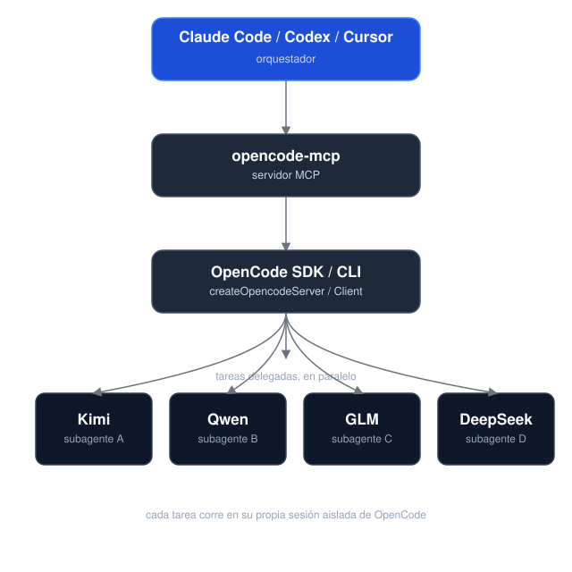

# opencode-mcp

[](https://github.com/alejandro-technology/opencode-mcp/actions/workflows/ci.yml)
[](https://github.com/alejandro-technology/opencode-mcp/blob/main/vitest.config.ts)
[](https://www.npmjs.com/package/mcp-server-opencode)

An MCP (Model Context Protocol) server that lets any MCP host — Claude Code, Codex, Cursor, etc. — drive an [OpenCode](https://opencode.ai) instance and delegate work to its subagents — so orchestrator models like Opus or Fable can hand off tasks to the other models OpenCode exposes.

## Quick install

Requires **Node.js 18+** and **[OpenCode](https://opencode.ai)** installed and configured (`opencode` must be on your `PATH`, with at least one provider/model set up) — this server spawns and drives OpenCode instances.

For **Claude Code**:

```bash
claude mcp add opencode -- npx -y mcp-server-opencode
```

For **Codex**:
```bash
codex mcp add opencode -- npx -y mcp-server-opencode
```

See [Installation](#installation) for manual config, and from-source options.

## Tools

| Tool                       | Description                                                                                               |
| --------------------------- | -------------------------------------------------------------------------------------------------------- |
| `opencode_start_server`    | Start a new OpenCode server instance in the MCP process working directory                                 |
| `opencode_stop_server`     | Stop a running OpenCode server instance                                                                   |
| `opencode_list_agents`     | List agents/models available on a server instance (optional `directory` selects a project)                 |
| `opencode_start_task`      | Delegate a task to an agent by starting a new session and prompt (optional `agent` / `model` override)    |
| `opencode_continue_task`   | Send a follow-up prompt to an existing task's session for iterative back-and-forth with the subagent      |
| `opencode_cancel_task`     | Abort a running delegated task by cancelling its session                                                  |
| `opencode_cleanup_workspace` | Explicitly remove an owned Git worktree after task reports finalize; dirty worktrees require opt-in discard |
| `opencode_get_task_status` | Poll the status of a delegated task (`pending` / `running` / `completed` / `failed` / `empty` / `cancelled`); optional `include_progress` adds a partial output snippet and the currently running tool while it's still running |
| `opencode_get_task_result` | Fetch the final result of a completed task                                                                |
| `opencode_wait_for_task`   | Long-poll one or more delegated tasks until they finish (`mode: "all"` or `"any"`) or the timeout elapses; optional `include_progress` best-effort enriches unfinished tasks within the same deadline, falling back to the last observed status/progress when time runs out |

| Prompt          | Description                                                                                          |
| --------------- | ---------------------------------------------------------------------------------------------------- |
| `delegate_task` | Guides the host through delegating one or more tasks to OpenCode agents (start/wait/result workflow), including a model selection guide that maps each OpenCode model tier to the task difficulty it should handle |

## How it works


Task delegation is **asynchronous**: starting a task returns immediately with a `task_id` instead of blocking until the subagent finishes. This lets hosts fire multiple `opencode_start_task` calls in parallel — each opens an isolated OpenCode `Session` — without hitting MCP client timeouts on long-running work. Tasks use the selected directory directly by default; managed Git worktrees are an explicit opt-in. Status and results are fetched separately via polling. If the prompt ACK transport is lost after OpenCode may have accepted the request, the tool returns `dispatch_uncertain` with task/run IDs and retains its lease; poll that task or cancel it rather than retrying the prompt as a new task. Definite HTTP 4xx rejection rolls back provisional run state and lease.

Each accepted start or continuation prompt also receives a `run_id`. Status, progress, and results are scoped to that prompt's explicit message ID, while progress evidence remains cumulative across turns in the same run. `empty` and `cancelled` are terminal outcomes. A cancelled task can be continued; the accepted continuation becomes the current run and clears the previous cancellation state. Concurrent continuation dispatches for the same task are rejected with `dispatch_in_progress`.

OpenCode 1.18.34 requires caller message IDs to start with `msg`; the MCP uses `msg_${randomUUID()}` for both start and continuation prompts. The opt-in harness also probes a bare UUID through the installed SDK/runtime using an invalid provider/model so the identifier contract can be checked without a paid request.

### Execution reports and caller checks

`opencode_start_task` and `opencode_continue_task` accept optional `expected_changes` (`[{ path, change }]`, where `change` is `created`, `modified`, or `deleted`) and `checks` (`[{ executable, argv, cwd?, timeout_ms? }]`). Paths and check working directories are relative to the server workspace; checks run directly with `shell: false`. Reports are additive on status/result as `run_id`, `changes`, `verification`, `diagnostics`, and `evidence`. `opencode_get_task_result` and `opencode_get_task_status` accept an optional `run_id` to retrieve a historical run; omitted means the current run.

### Shared directories and managed worktrees

`opencode_start_task` accepts `directory` (relative to the server directory, defaulting to it), `workspace_mode` (`shared` by default or `worktree`), and `base_ref` (worktree mode only, default `HEAD`). The selected directory must already exist. Shared mode runs directly in that canonical directory. Worktree mode creates a unique detached Git worktree at the selected committed ref; source modifications and untracked files are neither copied nor altered. When the selected base does not contain the requested nested source directory, the request fails instead of silently changing the execution directory.

Start, status, result, wait, and historical-run payloads expose a `workspace` object with source and execution directories, mode, managed state, and (for worktrees) `workspace_id`, base commit, source dirty state, and lifecycle state. SDK requests are bound to the selected directory through OpenCode's directory routing. Permission responders are keyed by server and canonical directory and answer only sessions registered to that scope.

Accepted worktrees are retained after task completion. Call `opencode_cleanup_workspace` with the returned `workspace_id` after reports are finalized. Cleanup serializes against task continuation/dispatch, rejects unfinished reports and dirty worktrees, and removes only worktrees provisioned by this MCP process. Set `discard_changes: true` only when changes inside that owned worktree should be discarded. Cleanup never removes source files; cached results, usage, and historical runs remain readable after the worktree is removed.

### Usage reporting

Status, wait, and result payloads include an additive `usage` snapshot. Its `run` summary selects direct assistant messages whose `parentID` matches that run's user-message ID; `session` summarizes all direct assistant messages observed in the session snapshot. Neither includes descendants or separate subagent sessions. Per-provider/model breakdowns preserve raw input, output, reasoning, cache-read, cache-write, and OpenCode-reported cost independently; token categories are not combined into a potentially overlapping total. Step-finish part metrics are excluded.

Each metric has a nullable `value`, `complete` flag, and `missing_messages` count. Missing, invalid, or negative values remain unknown; explicit zero is known. Empty snapshots do not claim zero consumption. Cost is labeled as OpenCode-reported, with currency unspecified; it is not an invoice total. `captured_at` and `snapshot_kind` identify the observation. A finalized run caches its own run and session snapshot, so retrieving an older `run_id` after a continuation returns the historical session snapshot from that run's finalization—not a current cumulative total. Failed message reads return `report: null` with a diagnostic.

The MCP server captures a bounded workspace inventory before accepted dispatch and after execution. The inventory recursively hashes workspace files except `.git` and `node_modules`; caller-declared expected paths are also checked explicitly, including paths inside otherwise skipped directories. Created/untracked, modified (including pre-existing dirty files changed since baseline), deleted, binary, and symlink entries are reported. Changes are labeled `workspace_delta`: concurrent or unmanaged writers can still make attribution uncertain. A verified run holds an exclusive lease across the canonical workspace and overlapping directories; it blocks verified and ordinary MCP task writers and conflicts fail fast with `workspace_busy`. Ordinary unverified runs may share a workspace. `session.diff` is not used as task provenance. Capture errors, missing expected changes, and scope limits are disclosed. `opencode_wait_for_task` supports `until: "execution"` (default) or `until: "report"`; report waits end on finalized failed, unavailable, or cancelled reports while respecting the whole-call timeout.

Each accepted run retains its own baseline, criteria, lease, result, report, and finalized usage snapshot. Checks are executed once by the background lifecycle observer after terminal execution. Their result includes exit code/signal, duration, bounded output and exact truncation flags; timeout/cancellation terminates the child process group. Verification may be `not_requested`, `pending`, `running`, `passed`, `failed`, `unavailable`, or `cancelled`; execution success alone does not mean verification passed. Final task text/progress, reports, and usage snapshots are cached, so result queries do not rerun checks and historical results remain available after a continuation or backend removal. Workspace inventories are capped at 20,000 entries and 32 MiB of file content; check output is capped at 16 KiB per stream. These limits and shared-workspace attribution mean the report is evidence, not proof of exclusive authorship.

Run the opt-in real OpenCode stdio smoke harness with `pnpm smoke`. It uses only `openai/gpt-6-luna` for its paid prompts, creates and removes temporary fixtures, and checks real reports/usage, historical retrieval, no-change and cancellation continuations, two detached worktrees editing the same relative file independently, an external read permission in a scoped worktree session, continuation in that worktree, dirty-cleanup refusal, explicit discard, and cached history after removal. The no-model identifier probe is also runnable with `node --experimental-strip-types scripts/smoke.ts --message-id-only`. The paid smoke is intentionally not part of default CI because it requires configured credentials.

## Installation

### Prerequisites

- **Node.js 18+**
- **[OpenCode](https://opencode.ai)** installed and configured (`opencode` must be on your `PATH`, with at least one provider/model set up) — this server spawns and drives OpenCode instances.

### Option 1 — npm (recommended)

The package is published as [`mcp-server-opencode`](https://www.npmjs.com/package/mcp-server-opencode). No cloning or building needed — point your MCP host at `npx`:

For **Claude Code**, one command does it:

```bash
claude mcp add opencode -- npx -y mcp-server-opencode
```

Or manually

```json
{
  "mcpServers": {
    "opencode": {
      "command": "npx",
      "args": ["-y", "mcp-server-opencode"]
    }
  }
}
```

For **Codex**, add the server to `~/.codex/config.toml`:

```toml
[mcp_servers.opencode]
command = "npx"
args = ["-y", "mcp-server-opencode"]
```

Or install it globally and use the binary directly:

```bash
npm install -g mcp-server-opencode
```

```json
{
  "mcpServers": {
    "opencode": {
      "command": "opencode-mcp"
    }
  }
}
```

### Option 2 — from source

```bash
git clone https://github.com/alejandro-technology/opencode-mcp.git
cd opencode-mcp
pnpm install
pnpm build
```

Then point your MCP host at the built entrypoint:

```json
{
  "mcpServers": {
    "opencode": {
      "command": "node",
      "args": ["/path/to/opencode-mcp/build/src/index.js"]
    }
  }
}
```

Restart your MCP host after editing the config; the `opencode_*` tools should appear in its tool list.

## Configuration

### `MCP_TOOL_TIMEOUT`

`opencode_wait_for_task` accepts a `timeout_ms` input, but it's clamped to a server-side maximum so a single call can't block the MCP connection indefinitely. That maximum defaults to **300000 ms (5 minutes)** and is configurable via `MCP_TOOL_TIMEOUT`.

`MCP_TOOL_TIMEOUT` can be set two ways:

- **Environment variable** — set it in the MCP server config:

  ```json
  {
    "mcpServers": {
      "opencode": {
        "command": "node",
        "args": ["/path/to/opencode-mcp/build/src/index.js"],
        "env": { "MCP_TOOL_TIMEOUT": "1200000" }
      }
    }
  }
  ```

- **CLI argument** — pass `MCP_TOOL_TIMEOUT=<ms>` as an extra arg to the server process:

  ```json
  {
    "mcpServers": {
      "opencode": {
        "command": "node",
        "args": [
          "/path/to/opencode-mcp/build/src/index.js",
          "MCP_TOOL_TIMEOUT=1200000"
        ]
      }
    }
  }
  ```

If both are present, the **environment variable takes precedence** over the CLI argument. Invalid or non-numeric values fall back to the 300000 ms default.

## Development

### Project structure

```
src/
├── index.ts                   # MCP server entrypoint (stdio transport, shutdown handlers)
└── modules/
    ├── tools/                 # One file per MCP tool, registered in index.ts
    ├── prompts/               # One file per MCP prompt, registered in index.ts
    └── shared/                # Cross-tool infrastructure
        ├── server-registry.ts   # Tracks running OpenCode servers; killAllServers() on shutdown
        ├── task-registry.ts     # Maps task_id → OpenCode server + session
        ├── opencode-client.ts   # Builds SDK clients from the registries
        ├── config.ts            # MCP_TOOL_TIMEOUT resolution (env var / CLI arg)
        └── mcp-result.ts        # jsonResult / jsonError MCP output helpers
```

Each module ships with a `*.test.ts` Vitest suite under the parallel `tests/` tree mirroring `src/`.

### Getting started

```bash
pnpm install
pnpm dev     # runs the server through the MCP Inspector (tsx, no build needed)
```

Other scripts:

```bash
pnpm test           # vitest run
pnpm test:coverage  # vitest run --coverage
pnpm lint           # biome check
pnpm lint:write     # biome check --write
pnpm build          # clean tsc build to ./build (also the typecheck)
```
